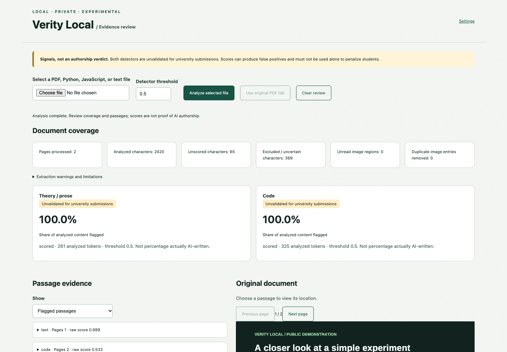
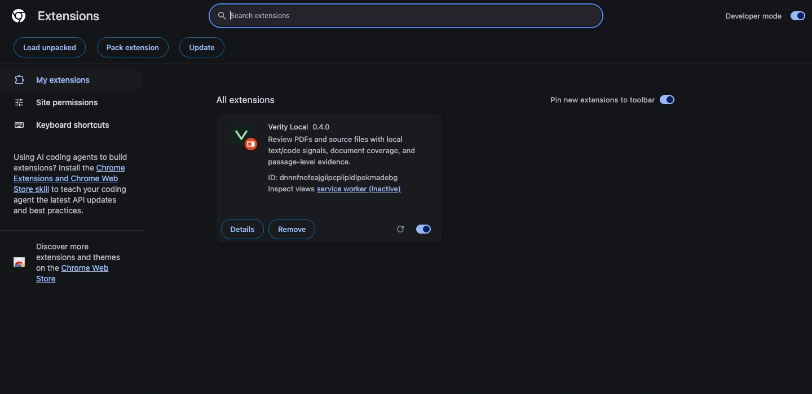
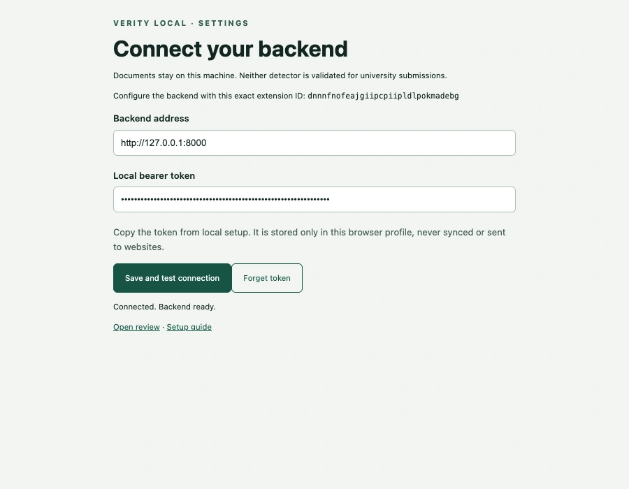
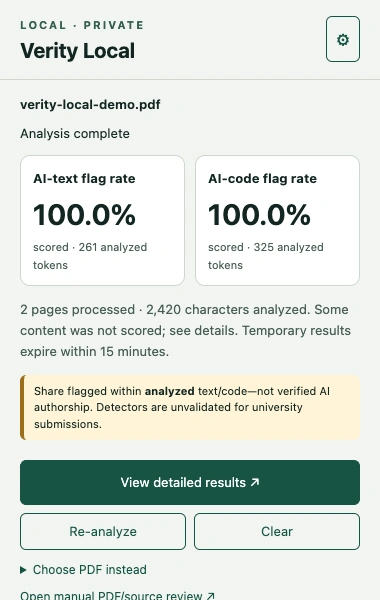
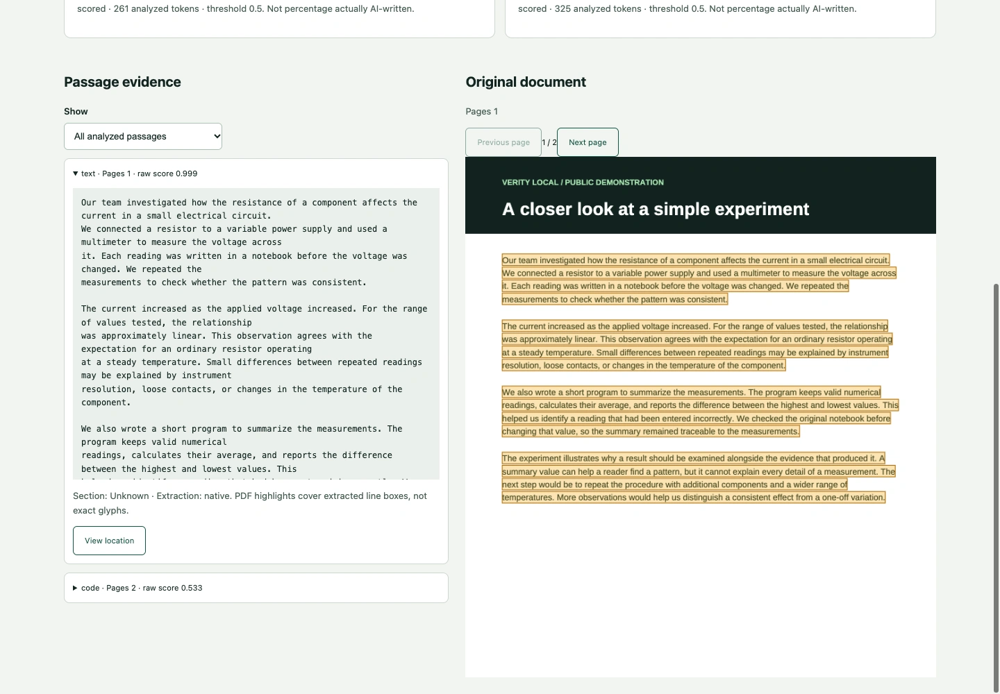

<p align="center"></p>

<h1 align="center">Verity Local</h1>
<p align="center"><strong>A closer look. Without the cloud.</strong><br>Local PDF and source-file review, with separate text/code signals and evidence you can inspect.</p>
<p align="center"><a href="https://veritylocal.github.io/">Website</a> · <a href="https://veritylocal.github.io/#setup">Setup guide</a> · <a href="https://github.com/VerityLocal/Main/releases/tag/v0.4.0">Downloads</a> · <a href="https://github.com/VerityLocal/Main/issues">Issues</a></p>



## What it does

- **Review a PDF from your browser.** A compact Chrome/Edge popup captures the current PDF or accepts a chosen file. Analysis continues when the popup closes.
- **Inspect the original evidence.** Open detailed results, filter analyzed/flagged/unscored passages, and jump to highlighted PDF locations or exact source lines.
- **Keep text and code separate.** English prose uses the local Desklib detector. Python/JavaScript uses a local CodeBERT + custom LoRA style detector.
- **See the coverage.** Unread images, excluded material, short passages, and unsupported languages are reported explicitly.
- **Run on your computer.** A local Python service performs extraction and inference. PDF.js is bundled in the extension; documents are not sent to an external inference service.

Detector outputs are experimental signals, not proof of authorship. The percentages show the share of **analyzed content** flagged at the selected threshold. The code model is a synthetic-style classifier; neither detector is validated for university submissions.

## Downloads — v0.4.0

| Download | Contains |
| --- | --- |
| [**Verity Local project ZIP**](https://github.com/VerityLocal/Main/releases/download/v0.4.0/Verity-Local-v0.4.0.zip) | Python backend, ready-to-load extension, source, documentation, and examples |
| [**Chrome / Edge extension ZIP**](https://github.com/VerityLocal/Main/releases/download/v0.4.0/Verity-Local-Extension-v0.4.0.zip) | Ready-to-load extension with local PDF.js; requires the backend |
| [Text model ZIP](https://github.com/VerityLocal/Main/releases/download/v0.4.0/Verity-Local-Text-Model-v0.4.0.zip) | Pinned Desklib text weights and tokenizer |
| [Code model ZIP](https://github.com/VerityLocal/Main/releases/download/v0.4.0/Verity-Local-Code-Model-v0.4.0.zip) | Pinned CodeBERT backbone, custom adapter, and tokenizer |
| [SHA-256 checksums](https://github.com/VerityLocal/Main/releases/download/v0.4.0/SHA256SUMS.txt) | Checksums for all four ZIPs |

The models occupy about **2.1 GiB uncompressed** and are distributed as release assets. The setup command downloads them and verifies every inference artifact. Existing verified models are reused.

## Setup

The backend requires **Python 3.11+ on macOS or Linux**. On Windows, run it in **WSL 2** and use the extension in Windows Chrome/Edge. Chrome 116+ or compatible Edge is required. Allow several GB of free storage and RAM; 16 GB RAM is recommended. macOS Apple Silicon is the locally validated platform.

### 1. Get the project

Extract the [project ZIP](https://github.com/VerityLocal/Main/releases/download/v0.4.0/Verity-Local-v0.4.0.zip) and open a terminal inside its `verity-local/` folder, or clone:

```sh
git clone https://github.com/VerityLocal/Main.git verity-local
cd verity-local
```

### 2. Install the backend and models

```sh
python3 -m venv .venv
source .venv/bin/activate
python -m pip install --upgrade pip
python -m pip install -r requirements.txt
python -m backend.scripts.download_models
```

The first install requires internet. Once dependencies and models are installed, analysis runs locally. For manually downloaded model ZIPs:

```sh
python -m backend.scripts.download_models --from-dir ~/Downloads
```

### 3. Load the extension

The project release ZIP already includes the built extension. **Git clones** need Node.js 22.13+ and this build step:

```sh
cd extension
npm ci --ignore-scripts
npm run build
cd ..
```

1. Open `chrome://extensions` (Edge: `edge://extensions`).
2. Turn on **Developer mode** and click **Load unpacked**.
3. Select the `extension/` folder containing `manifest.json`.
4. Copy the 32-character **extension ID** from its card.



### 4. Start and connect

From the project root, with the virtual environment active, replace `YOUR_EXTENSION_ID` with the ID you just copied:

```sh
python -B -m backend.scripts.run_local --extension-id YOUR_EXTENSION_ID
```

Leave that terminal running. Startup loads and checks both models. Open Verity Local's **Settings**, use `http://127.0.0.1:8000`, and paste the token from `.local/backend-token` into **Local bearer token**. Click **Save and test connection**; the expected result is **Connected. Backend ready.**

In a second terminal, from the project root, copy the token with `pbcopy < .local/backend-token` on macOS, or display it with `cat .local/backend-token` on Linux. In WSL, use `clip.exe < .local/backend-token`.



### 5. Review your first document

Open the [two-page demonstration PDF](docs/examples/verity-local-demo.pdf), click the Verity Local toolbar icon, and choose **Choose PDF instead** if direct capture is unavailable. Click **View detailed results** to inspect passages and their locations. Manual review also accepts `.py`, `.js`, and UTF-8 `.txt` files.

**[Complete setup and troubleshooting →](docs/SETUP.md)**

## Screenshots

| Quick review | Passage-level evidence |
| --- | --- |
|  |  |

Screenshots use the included synthetic demonstration files. Displayed scores illustrate the interface, not detector accuracy.

## Project layout

```text
backend/       Local API, parsers, models, and Python tests
extension/     Manifest V3 extension, PDF.js build, and JS tests
models/        Tokenizers, model metadata, and downloaded weights
docs/          Setup guide, screenshots, model notes, and public examples
scripts/       Asset generation and reproducible release packaging
test/          Original, unlabeled PDF evaluation samples
```

## Development

```sh
python -m pip install -r requirements-dev.txt
python -B -m unittest discover -s backend/tests -v
npm --prefix extension test
```

Run offline integration tests with the installed model weights:

```sh
PDF_AI_RUN_MODEL_TESTS=1 HF_HUB_OFFLINE=1 TRANSFORMERS_OFFLINE=1 \
  python -B -m unittest discover -s backend/tests -v
```

- [Backend API and configuration](backend/README.md)
- [Extension behavior and browser tests](extension/README.md)
- [Model provenance, integrity, and interpretation](docs/MODELS.md)
- [Dependencies and optional OCR](backend/DEPENDENCIES.md)
- [Release notes](CHANGELOG.md)

## Repositories

- [`VerityLocal/Main`](https://github.com/VerityLocal/Main): application, documentation, and releases.
- [`VerityLocal/.github`](https://github.com/VerityLocal/.github): organization profile README.
- [`VerityLocal/veritylocal.github.io`](https://github.com/VerityLocal/veritylocal.github.io): download website and illustrated setup guide.
