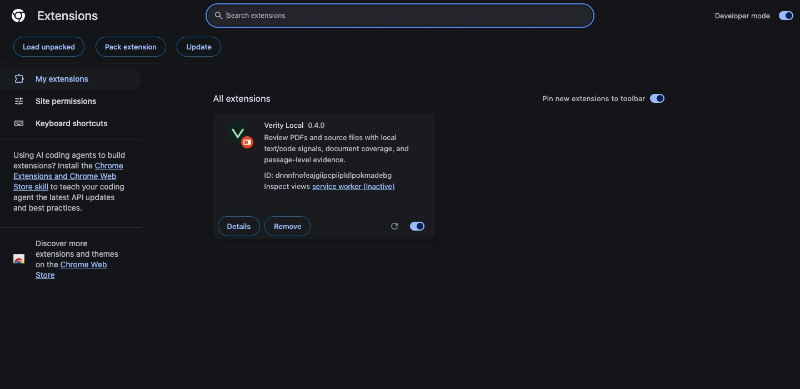
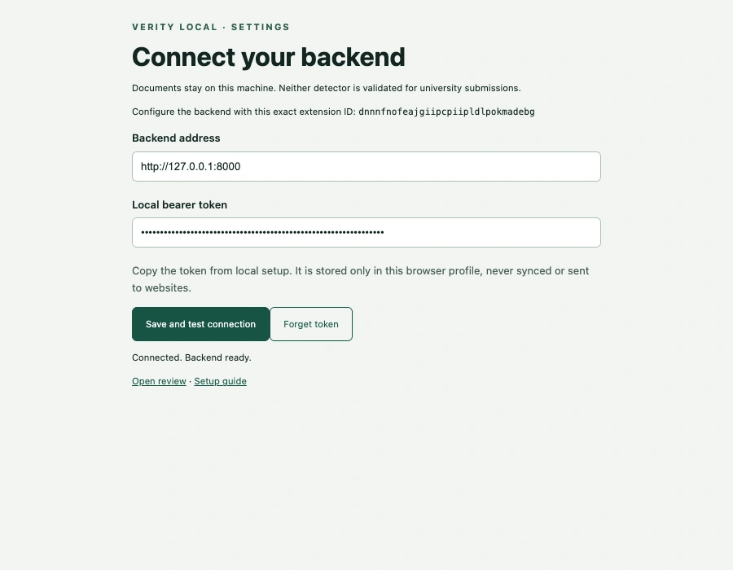
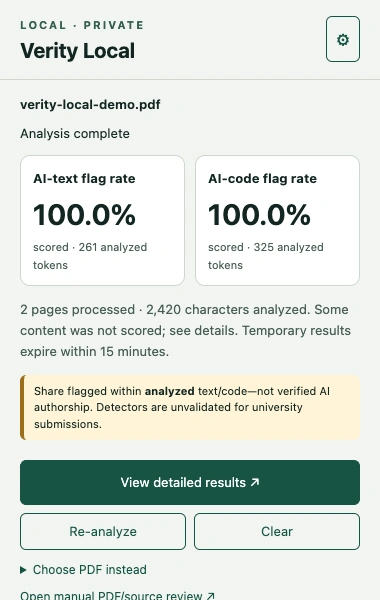

# Set up Verity Local

[Website guide](https://veritylocal.github.io/#setup) · [Downloads](https://github.com/VerityLocal/Main/releases/tag/v0.4.0) · [Project README](../README.md)

## What you need

| Component | Requirement |
| --- | --- |
| Browser | Chrome 116+ or compatible Microsoft Edge |
| Backend | Python 3.11+ on macOS or Linux; WSL 2 on Windows |
| Memory | Several GB available; 16 GB physical RAM recommended |
| Storage | Plan for at least 8 GB free for packages, model downloads, and installation staging |
| Network | Required to obtain packages/models; inference runs offline after setup |
| Node.js | 22.13+ only when building the extension from a Git clone |

The locally tested setup is Apple Silicon macOS, Python 3.14.6, CPU inference, and Chrome for Testing. Linux and Windows/WSL instructions use the same Python source; they are not native desktop installers. The parser uses POSIX subprocess groups, so run it inside WSL rather than native Windows Python.

## 1. Download and extract

Download [Verity-Local-v0.4.0.zip](https://github.com/VerityLocal/Main/releases/download/v0.4.0/Verity-Local-v0.4.0.zip). Extract the archive; the project directory is named `verity-local`.

The project ZIP includes the built `extension/` folder. The separate [extension ZIP](https://github.com/VerityLocal/Main/releases/download/v0.4.0/Verity-Local-Extension-v0.4.0.zip) is useful for updating an existing installation or keeping the extension in Windows while the backend runs in WSL. Extract it to find `verity-local-extension/`.

Alternatively, clone the repository:

```sh
git clone https://github.com/VerityLocal/Main.git verity-local
cd verity-local
```

## 2. Prepare Python

### macOS

Install Python 3.11 or newer from [python.org](https://www.python.org/downloads/macos/) or your package manager. Open Terminal inside `verity-local`:

```sh
python3 --version
python3 -m venv .venv
source .venv/bin/activate
python -m pip install --upgrade pip
python -m pip install -r requirements.txt
```

### Linux (Ubuntu / Debian)

Install Python and virtual environment support if needed:

```sh
sudo apt update
sudo apt install python3 python3-venv python3-pip
```

Check `python3 --version` is at least 3.11. From the project directory:

```sh
python3 -m venv .venv
source .venv/bin/activate
python -m pip install --upgrade pip
python -m pip install torch==2.13.0 --index-url https://download.pytorch.org/whl/cpu
python -m pip install -r requirements.txt
```

The CPU-only PyTorch index avoids downloading unused CUDA packages on Linux/WSL.

### Windows (WSL 2)

1. Install Ubuntu using [Microsoft's WSL instructions](https://learn.microsoft.com/windows/wsl/install). A new installation generally starts with `wsl --install` in an Administrator PowerShell, followed by a restart.
2. Open **Ubuntu**, not a native Windows Python terminal.
3. Place the extracted project in your Linux home directory, or clone it there. Follow the Linux steps above.
4. Download and extract the separate extension ZIP in Windows. Load that folder in Windows Chrome/Edge in step 4.

WSL normally forwards the Linux service to Windows `127.0.0.1:8000`. If it does not connect, check [Microsoft's localhost networking guidance](https://learn.microsoft.com/windows/wsl/networking). Keep the backend bound to loopback.

## 3. Download the models

From the project root, with `.venv` active:

```sh
python -m backend.scripts.download_models
```

This downloads the text and code model ZIPs from the **v0.4.0 GitHub release**. It verifies all pinned SHA-256 hashes in a staging directory before installing the files. Verified existing models are skipped. Allow time for roughly 2 GB of data.

### Manual or offline installation

Download both [Text Model](https://github.com/VerityLocal/Main/releases/download/v0.4.0/Verity-Local-Text-Model-v0.4.0.zip) and [Code Model](https://github.com/VerityLocal/Main/releases/download/v0.4.0/Verity-Local-Code-Model-v0.4.0.zip) ZIPs. Copy them to the target computer, then run:

```sh
python -m backend.scripts.download_models --from-dir /path/to/downloads
python -m backend.scripts.download_models --check
```

The final layout is:

```text
verity-local/
  models/
    text_detector/model.safetensors
    text_detector/tokenizer.json
    ...
    code_detector/pytorch_model.bin
    code_detector/adapter.safetensors
    ...
```

Keep additional documentation outside the two detector folders: the runtime checks the exact set of allowed artifact names. For a custom models location, use `--models-dir /path/to/models` during installation and `PDF_AI_MODELS_DIR=/path/to/models` when launching.

## 4. Load the browser extension

For a **Git clone**, build the local PDF.js bundle first:

```sh
cd extension
npm ci --ignore-scripts
npm run build
cd ..
```

For a release ZIP, that build is already done.

1. Enter `chrome://extensions` in the address bar. In Edge, use `edge://extensions`.
2. Enable **Developer mode**.
3. Click **Load unpacked**.
4. Select the extracted `extension/` or `verity-local-extension/` folder itself. `manifest.json` must be directly inside it.
5. Copy the **ID** displayed on the Verity Local card. The ID is specific to your installation; do not copy the one in the screenshot.
6. Pin Verity Local using the browser's Extensions menu.



## 5. Start the local backend

From `verity-local/`, replace the placeholder with your actual extension ID:

```sh
source .venv/bin/activate
python -B -m backend.scripts.run_local --extension-id YOUR_EXTENSION_ID
```

The launcher creates `.local/backend-token`, checks the installed artifacts, and loads the models once. Leave this terminal open while reviewing. Startup may take a while; wait for Uvicorn's application-startup-complete message. Stop with **Ctrl+C**.

Only one exact extension origin is authorized per backend process. To use a different browser/profile, restart with its extension ID. If you move an unpacked extension folder, its ID can change.

## 6. Connect the extension

Open the extension popup and click the **gear**. In Settings:

- **Backend address:** `http://127.0.0.1:8000`
- **Local bearer token:** the contents of `.local/backend-token`

In a second terminal, from the project directory:

```sh
# macOS: copy without displaying the token
pbcopy < .local/backend-token

# Linux: display it locally, then copy it
cat .local/backend-token

# WSL: copy to the Windows clipboard
clip.exe < .local/backend-token
```

Choose the command for your system. Click **Save and test connection**. Success reads **Connected. Backend ready.** The token field remains masked.



## 7. Try a document

Use the public [demonstration PDF](examples/verity-local-demo.pdf), [Python file](examples/measurements.py), or [text file](examples/experiment.txt).

- **Current PDF:** open a PDF and click Verity Local. If requested, choose **Allow this site & analyze** for that site.
- **File upload:** choose **Choose PDF instead**, then pick a PDF. Keep the popup open while the file transfers; you can close it after submission.
- **Detailed review:** click **View detailed results**. Use **Show → All analyzed passages** and **View location** to inspect evidence in the original document.
- **Source files:** click **Open manual PDF/source review** and select `.py`, `.js`, or UTF-8 `.txt`.



Uploads are limited to 50 MiB and 500 PDF pages. Direct capture from a browser tab is limited to 8 MiB; use file upload for larger PDFs. Local `file://` PDFs may need **Allow access to file URLs** in the extension details. Manual upload works without that setting. Protected/embedded viewers may also need manual upload.

## Troubleshooting

| Symptom | Fix |
| --- | --- |
| `python3` unavailable or older than 3.11 | Install a supported Python and recreate `.venv` with that interpreter. |
| `No module named ...` | Activate `.venv` and run `python -m pip install -r requirements.txt`. |
| PDF.js / `vendor/pdf.mjs` missing | Use the release ZIP, or run `npm ci --ignore-scripts` and `npm run build` inside `extension/`. |
| Connection refused / failed to fetch | Start the backend, wait for model loading, and confirm the address and port. On Windows, check WSL localhost forwarding. |
| HTTP 401 | Copy the current token from this project's `.local/backend-token`; save again. |
| HTTP 403 / origin unauthorized | Restart with the exact extension ID currently shown in Settings. |
| HTTP 503 / model unavailable | Read the backend log and run `python -m backend.scripts.download_models --check`. Install missing artifacts with the downloader. |
| Port 8000 already in use | Start with `--port 8001` and set the extension address to `http://127.0.0.1:8001`. |
| `Not scored` | Review coverage: content may be too short, unsupported, unread, or excluded. It is not a zero score. |
| Scanned pages unread | Install local Tesseract plus English data; see [optional OCR](../backend/DEPENDENCIES.md). |
| Models need more memory | Close memory-heavy apps, keep one backend process, or set `PDF_AI_BATCH_SIZE=1` before launching. |
| Unpacked extension updated | Click **Reload** on its extensions card; restart the backend if its ID changed. |

## Returning later

The models and token stay installed. Each session needs the running backend:

```sh
cd /path/to/verity-local
source .venv/bin/activate
python -B -m backend.scripts.run_local --extension-id YOUR_EXTENSION_ID
```

Completed results are in memory and expire. Clearing a review releases its local display/session; it does not cancel an already submitted job. See the [backend reference](../backend/README.md) for resource limits and retention details.
