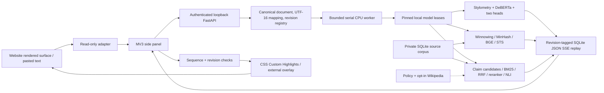

# Architecture and end-to-end dataflow

**Executable CPU baseline across all phases; not production-validated.** See
[implementation status](implementation_status.md) and [remaining decisions](decisions.md).

## Execution boundaries

1. User-triggered extraction excludes private controls, hidden elements, scripts,
   navigation and excluded domains. Only rendered content is claimed. Separate
   editor-shaped adapters are not editor document-model integrations.
2. Blocks preserve original text and stable IDs, joined with `\n\n`; coordinates
   are half-open UTF-16. `/analyses/text` constructs canonical normalization maps
   on the backend and validates every block position, revision and text slice.
3. Host/origin/authentication/CSRF/request bounds run before JSON parsing.
   Revision identity rejects stale documents and changed same-revision content.
4. One async queue runs synchronous engines via `asyncio.to_thread`. Each engine
   is independent; a model/profile failure becomes unavailable without disabling
   the others. CPU model leases serialize residency and track references. GPU
   execution is disabled until measured admission profiles exist.
5. AI inference requires a trained artifact with matching feature schema, model
   revisions, resource versions and CPU calibration. Unique-token-coverage weights
   aggregate representations across overflow windows before independent heads.
   Untrained base-model logits are never served as AI detection.
6. Similarity separates candidate retrieval, original-offset lexical alignment,
   and STS candidate verification. Claims separate extraction, related-pair
   retrieval, evidence retrieval, reranking, NLI and source-trust aggregation.
   Neutral/missing evidence is not contradiction. No catch-all classifier is shared.
7. Each SSE envelope carries request ID, document ID/revision, sequence, UTC time,
   offset unit and diagnostics. Detailed claim events are stored once; completion
   summarizes rather than duplicating all evidence. Streams are bounded connections
   that reconnect with `Last-Event-ID`.
8. The side panel owns streaming; the MV3 worker coordinates short state updates.
   Request/cursor identity persists. Reopening rebuilds the UI from history with
   cursor zero, avoiding an empty UI paired with a nonzero saved cursor.
   Manual edits/page mutations invalidate old findings and cancel active analysis.
9. Read-only ranges or an external closed-shadow overlay render highlights. No
   editor-owned node replacement, input-value mutation or private-global access.

## Persistence and cancellation

The in-memory TTL revision registry stores only hashes. SQLite stores private
sources and bounded replay events under a non-synced local application-data path
by default. Restart terminates unfinished requests with `backend_restarted`;
replay does not pretend to resume lost inference. New work must be resubmitted.

Cancellation/deadlines are cooperative. A native model call cannot be preempted;
the next request waits until its thread actually returns. Cancelled/evicted history
must not kill the worker. No multiple backend workers or training/live GPU overlap.

API routes and operational bounds are listed in the [README](../README.md) and
[implementation status](implementation_status.md). Interactive API docs are disabled;
six JSON Schema contracts are exported under `shared/schemas`.
